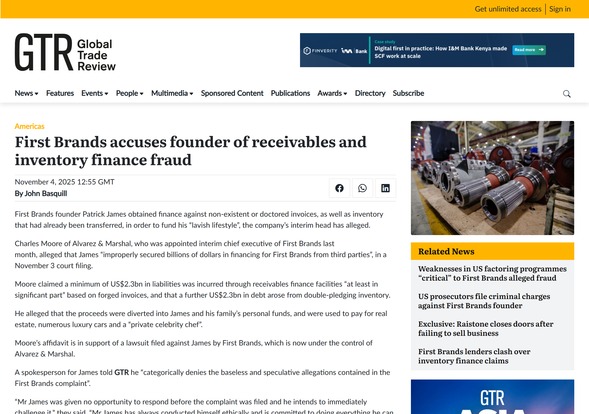

<p align="center">
  
</p>

<h1 align="center">Unpledged</h1>

<p align="center">
  <strong>Confidential receivables financing on Canton DevNet</strong><br/>
  Prove an invoice is unpledged without disclosing the book · block double-pledge at commit · verify privacy in the transaction tree
</p>

<p align="center">
  <a href="https://unpledged.vercel.app">Live demo</a> ·
  <a href="https://github.com/Demiladepy/Unpledged">GitHub</a> ·
  <a href="./DEMO_VIDEO_REPORT.md">Demo guide</a> ·
  <a href="./docs/architecture/unpledged-architecture.excalidraw">Architecture (Excalidraw)</a>
</p>

<p align="center">
  
  
  
  
</p>

---

## The problem (2025–2026, named, dollar amounts)

Competing lenders cannot share their books — confidentiality is structural. Without a shared view of encumbrance, the **same receivable can be pledged twice**. In 2025–2026 this stopped being theoretical:

| Case | Mechanism | Scale | Source |
|------|-----------|-------|--------|
| **First Brands** | Invoice factoring / receivables fraud; creditor alleges funds “vanished”; court examiner on double-sold invoices | **~$2.3B** unaccounted (creditor filing); forged invoices + **~$2.3B** double-pledged inventory alleged | [Reuters](https://www.reuters.com/world/us/first-brands-creditor-says-23-billion-simply-vanished-seeks-probe-2025-10-09/) · [GTR](https://www.gtreview.com/news/americas/first-brands-accuses-founder-of-receivables-and-inventory-finance-fraud/) |
| **Tricolor** | **Double-pledged collateral** to multiple lenders; fabricated / manipulated loan data | **~$2.2B** pledged vs **~$1.4B** real collateral → **~$800M** bogus collateral | [DOJ SDNY](https://www.justice.gov/usao-sdny/pr/ceo-cfo-coo-charged-connection-billion-dollar-collapse-tricolor-auto) |
| **JPMorgan** | Exposure to Tricolor collapse | **$170M** Q3 charge-off; Dimon: “when you see one cockroach, there are probably more” | [Banking Dive](https://www.bankingdive.com/news/jpmorgan-dimon-tricolor-chargeoff-earnings/802740/) · [Reuters](https://www.reuters.com/business/finance/jpmorgan-ceo-says-its-exposure-collapsed-auto-dealer-tricolor-not-our-finest-2025-10-14/) |

<p align="center">
  <em>Primary sources (screenshots in repo — open links for full articles; some publishers block automated capture)</em>
</p>

<table>
<tr>
<td width="50%" valign="top">
<a href="https://www.gtreview.com/news/americas/first-brands-accuses-founder-of-receivables-and-inventory-finance-fraud/">

</a>
<br/><sub><strong>First Brands</strong> — forged invoices & double-pledged inventory (GTR, Nov 2025)</sub>
</td>
<td width="50%" valign="top">
<a href="https://www.justice.gov/usao-sdny/pr/ceo-cfo-coo-charged-connection-billion-dollar-collapse-tricolor-auto">

</a>
<br/><sub><strong>Tricolor</strong> — systematic double-pledge & lender fraud (DOJ SDNY, Dec 2025)</sub>
</td>
</tr>
<tr>
<td colspan="2" valign="top">
<a href="https://www.bankingdive.com/news/jpmorgan-dimon-tricolor-chargeoff-earnings/802740/">

</a>
<br/><sub><strong>JPMorgan</strong> — $170M charge-off tied to Tricolor (Banking Dive, Oct 2025)</sub>
</td>
</tr>
</table>

**Accuracy note:** First Brands is primarily **receivables / factoring** fraud; Tricolor is **auto-loan collateral double-pledge** (same failure mode, different asset class). The $170M figure is JPM’s disclosed Tricolor hit, not a third separate fraud case.

---

## What Unpledged does

Unpledged is a **Canton-native** workflow for confidential receivables financing:

1. **Selective disclosure** — SME proves “unpledged” via `ProveUnpledged`; lender receives a **summary attestation**, not the invoice book.
2. **Per-party privacy** — Lender B’s ACS on the same ledger shows **0 contracts** for INV-001; privacy is enforced by **stakeholders & informees**, not UI filters.
3. **Commit-time integrity** — `PledgeRegistry.RecordPledge` asserts `invoiceRef ∉ pledgedRefs`; second pledge → **`Invoice already pledged`** (HTTP 400 on live DevNet).
4. **Commit-model proof** — Lender A’s `CompleteFinancing` transaction-tree projection shows **Invoice nodes: 0**; `PreparePledge` runs under SME-only informees.

> **The privacy isn't in the interface. It's in the commit model.**

---

## Live demo

**https://unpledged.vercel.app**

| Route | What judges should see |
|-------|------------------------|
| [`/`](https://unpledged.vercel.app/) | **View as** Lender A vs B — same ACS query, different reality |
| [`/blocked`](https://unpledged.vercel.app/blocked) | Live double-pledge replay · transaction tree · Lighthouse links |
| [`/demo`](https://unpledged.vercel.app/demo) | Fresh `INV-DEMO-*` → attest → finance → block (full flow) |
| [`/lender`](https://unpledged.vercel.app/lender) | Lender A party view — attestation summary, pending offers |
| [`/sme`](https://unpledged.vercel.app/sme) | SME portfolio — request financing |

Header must show **● LIVE on Canton DevNet** + ledger heartbeat offset.

**Independent verification (Lighthouse):**

- [Lender A on DevNet](https://lighthouse.devnet.cantonloop.com/party/LenderA%3A%3A1220a14ca128063b8dc9d1ebb0bd22633be9f2168500f4dbc1ecaeb1855b14e5acf8)
- [SME](https://lighthouse.devnet.cantonloop.com/party/SME%3A%3A1220a14ca128063b8dc9d1ebb0bd22633be9f2168500f4dbc1ecaeb1855b14e5acf8) · [Lender B](https://lighthouse.devnet.cantonloop.com/party/LenderB%3A%3A1220a14ca128063b8dc9d1ebb0bd22633be9f2168500f4dbc1ecaeb1855b14e5acf8)

---

## Architecture

### System overview

Open in [Excalidraw](https://excalidraw.com) → **File → Open** → [`docs/architecture/unpledged-architecture.excalidraw`](./docs/architecture/unpledged-architecture.excalidraw)

```
┌─────────────────────┐     ┌──────────────────────────┐     ┌─────────────────────────────┐
│  React UI (Vite)    │     │  API proxies (no secrets │     │  Canton DevNet (Five North) │
│  /  /blocked  /demo │────▶│  in browser)             │────▶│  JSON Ledger API v2         │
│  LiveBadge Heartbeat│◀────│  POST /api/token         │◀────│  ACS · submit-and-wait      │
└─────────────────────┘     │  /api/ledger/* → proxy   │     │  transaction-tree-by-id     │
                              └──────────────────────────┘     │  Parties: SME·Debtor·A·B    │
                                                               └─────────────────────────────┘
```

| Layer | Technology | Notes |
|-------|------------|-------|
| Smart contracts | **Daml** LF 2.1, SDK **3.4.11** | `Invoice` · `Attestation` · `Financing` |
| Package ID | `3a6372bf…dc236d` | Pinned in `frontend/src/ledger/packageId.ts` |
| Frontend | React 19 · Vite 8 · Tailwind 4 | `frontend/` |
| Ledger access | JSON Ledger API **v2** | Browser → `/api/ledger` proxy (CORS-safe) |
| Auth | OAuth2 **client_credentials** | `CANTON_CLIENT_SECRET` server-only |
| Deploy | **Vercel** | Root dir `frontend` · `ledger-proxy` rewrite |

### On-ledger workflow

```
Invoice (SME+Debtor)
    → ProveUnpledged → UnpledgedAttestation (observer: Lender A only)
    → FinancingOffer (Lender A)
    → CompleteFinancing
         → PreparePledge (SME informees only)
         → AcceptFinancing → RecordPledge → PledgeMarker
    → 2nd CompleteFinancing on same invoiceRef
         → assert "Invoice already pledged" → REJECTED ✓
```

### Privacy & encumbrance (design choices)

| Concern | Implementation |
|---------|----------------|
| Lender never sees invoice line items | Lender is **not** an `Invoice` signatory/observer |
| Competitor sees nothing | Lender B ACS = empty; no central data honeypot |
| Double-pledge | `PledgeRegistry` tracks `pledgedRefs`; `RecordPledge` rejects duplicates |
| Auditable refusal | Live HTTP 400 + `DAML_FAILURE` + unchanged `PledgeMarker` count |
| Tree-level proof | `GET transaction-tree-by-id` as Lender A → **0** `Invoice:Invoice` nodes |

### Daml templates

| Template | Module | Role |
|----------|--------|------|
| `Invoice` | `Invoice` | SME + debtor sign; `PreparePledge` → `PledgeIntent` |
| `AttestationFactory` | `Attestation` | `ProveUnpledged` → summary attestation for one lender |
| `FinancingOffer` | `Financing` | Lender offer against attestation |
| `FinancingCoordinator` | `Financing` | `CompleteFinancing` orchestrates pledge + accept |
| `PledgeRegistry` | `Financing` | Encumbrance registry per SME |
| `PledgeMarker` | `Financing` | On-ledger proof of pledge to lender |

---

## Quick start (local · live DevNet)

```bash
cd frontend
cp .env.example .env
cp .env.server.example .env.server   # add CANTON_CLIENT_SECRET

npm install
npm run allocate:parties
npm run grant:act-as                 # re-run if 403 actAs errors
npm run create:invoice
npm run create:attestation
npm run create:financing

# allocate:parties writes VITE_PARTY_* ; ensure:
# VITE_USE_MOCKS=false
npm run dev
```

Open **http://localhost:5173**

---

## Verification (pre-demo / CI manual)

```bash
cd frontend
npm run grant:act-as          # #1 fix for 403
npm run smoke:ledger          # token + ledger-end
npm run verify:all            # privacy ACS + tree (Invoice nodes = 0)
npm run verify:demo-flow      # fresh INV-DEMO-* end-to-end
npm run verify:prod           # hosted URL smoke
```

**Expected wins:**

- `verify:live-ui` — Lender A has attestation; Lender B **0/0/0**
- `verify:tree` — **Invoice nodes in Lender A view: 0**
- `/blocked` → **Attempt second pledge** → lime **Fraud prevented on-chain** (HTTP 400 is success)

---

## Deploy (Vercel)

1. Import repo · **Root Directory** = `frontend`
2. **Production env:** `VITE_USE_MOCKS=false`, all `VITE_PARTY_*`, `VITE_CANTON_USER_ID=6`
3. **Server secrets:** `CANTON_CLIENT_SECRET` + auth URL / client id / audience / scope
4. Proxy: `vercel.json` rewrites `/api/ledger/(.*)` → `api/ledger-proxy`
5. Post-deploy: `npm run verify:prod`

Full checklist: [SUBMISSION.md](./SUBMISSION.md)

---

## Demo & docs

| Doc | Purpose |
|-----|---------|
| [DEMO_SCRIPT.md](./DEMO_SCRIPT.md) | 3-minute spoken script |
| [DEMO_VIDEO_REPORT.md](./DEMO_VIDEO_REPORT.md) | Beat sheet + failure modes + pre-flight |
| [AUDIT.md](./AUDIT.md) | Codebase audit (routes, API, gaps) |
| [SUBMISSION.md](./SUBMISSION.md) | Judge / form brief |

---

## Canton alignment

Institutional privacy on Canton is **need-to-know disclosure**, not anonymity. Unpledged implements receivables encumbrance where:

- Privacy is enforced at **commit / informee** boundaries (transaction tree proves it).
- Fraud is blocked **on-ledger** (`PledgeRegistry`), not in application middleware.
- Judges can **independently verify** parties on [Lighthouse](https://lighthouse.devnet.cantonloop.com/).

Roadmap context: Canton’s longer-term priority includes **public verifiability mechanisms for private transactions** ([Messari overview](https://messari.io/report/understanding-canton-network-a-comprehensive-overview)) — Unpledged is the application-layer wedge for confidential receivables with provable encumbrance.

---

## Repo structure

```
unpledged/
├── daml/                 # Daml contracts + Test.daml
├── frontend/             # React app, API proxies, CLI verify scripts
├── docs/
│   ├── architecture/     # Excalidraw system + workflow diagram
│   └── research/         # Cited news screenshots (GTR, DOJ, Banking Dive)
├── DEMO_SCRIPT.md
├── DEMO_VIDEO_REPORT.md
├── AUDIT.md
└── SUBMISSION.md
```

---

## License & attribution

Built for **Canton DevNet** (Five North). Demo parties and package ID are pinned for reproducible judging. Do not commit `.env.server` or `CANTON_CLIENT_SECRET`.

**One line:** *Confidential receivables on Canton — per-party privacy you can click, double-pledge the ledger refuses live, commit-model privacy in the transaction tree. Not a mock. [unpledged.vercel.app](https://unpledged.vercel.app)*
